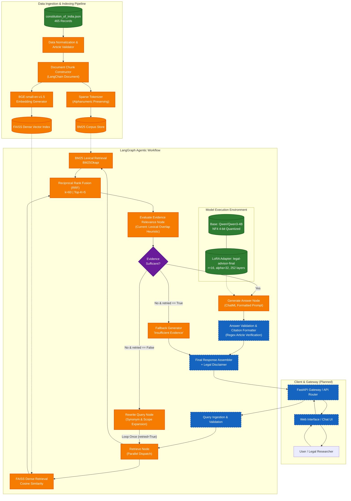

# System Architecture — Legal Advisor (Indian Constitution AI)

> **Document Status:** Comprehensive System Architecture & Engineering Blueprint  
> **Target System:** AI-Powered Legal Information Assistant for the Constitution of India  
> **Author:** Senior AI/ML Engineer & Systems Architect  
> **Last Updated:** November 2026  
> **Version:** 1.0.0-draft  

---

## 1. Project Overview

**Legal Advisor — Indian Constitution AI** is a specialized Retrieval-Augmented Generation (RAG) system engineered to answer legal questions regarding the **Constitution of India**. It grounds every response in retrieved constitutional provisions, cites relevant Articles (e.g., Article 14, Article 21, Article 51A), avoids speculative or unsupported claims, and explicitly acknowledges when sufficient evidentiary text is unavailable.

### Informational Status and Legal Disclaimer
```
========================================================================================
                                LEGAL NOTICE & DISCLAIMER
========================================================================================
This software is an automated informational and academic research assistant. It is NOT
a licensed advocate, law firm, or substitute for professional legal counsel. The outputs
generated by this system do not constitute formal legal opinions, advice, or representation
under the Advocates Act, 1961 or any applicable bar regulations. Users requiring legal advice
must consult a qualified advocate enrolled with a State Bar Council.
========================================================================================
```

### Architectural Principles
1. **Strict Evidence Grounding:** The generative model is constrained to retrieved statutory text; ungrounded generation is treated as a critical system fault.
2. **Deterministic Citation Provenance:** Every legal proposition must link to an authenticated Article or Schedule of the Constitution of India.
3. **Explicit Uncertainty:** If the retrieval pipeline fails to fetch relevant provisions with sufficient confidence, the system returns a standard non-hallucinatory disclaimer rather than extrapolating.
4. **Hybrid Retrieval Priority:** Combining lexical precision (for exact statutory terminology, article numbers, Latin legal maxims) with dense semantic retrieval (for conceptual and paraphrased inquiries).

---

## 2. Goals and Non-Goals

| Category | Objectives | Description |
| :--- | :--- | :--- |
| **Goals** | **Precise Constitutional Question Answering** | Accurately answer queries based exclusively on the text of the Constitution of India (Articles 1–395+, Amendments, and Preamble). |
| | **Hybrid Retrieval (Dense + Sparse)** | Marry FAISS dense semantic search (`BAAI/bge-small-en-v1.5`) with BM25 keyword matching via Reciprocal Rank Fusion (RRF). |
| | **Grounded Citation Formatting** | Extract and validate specific constitutional provisions and format citations cleanly in responses. |
| | **Controlled Generation** | Utilize a fine-tuned `Qwen/Qwen3-4B` model with PEFT LoRA in 4-bit NF4 quantization with strict stopping controls. |
| | **Agentic Self-Correction** | Implement a LangGraph state machine with an evidence-relevance check and a single bounded query-reformulation retry. |
| | **Reproducible Engineering** | Provide clear specifications for transition from exploratory notebooks to containerized microservices. |
| **Non-Goals** | **General Legal Advice** | No drafting of court petitions, litigation strategies, client representation, or case merits assessments. |
| | **Broad Statutory / Criminal Law** | Excludes the Indian Penal Code (IPC) / Bharatiya Nyaya Sanhita (BNS), Code of Criminal Procedure (CrPC) / BNSS, Indian Contract Act, and general statutory law. |
| | **Judicial Precedent / Case Law** | Does not index AIR, SCC, or Supreme Court judgment corpuses in the initial version (strictly statutory constitutional text). |
| | **Unbounded Autonomous Agents** | No multi-step autonomous browsing, internet searches, or unpredictable looping workflows. |
| | **Direct Replacement of Legal Counsel** | Never presents itself as an authorized advocate or legal practitioner. |

---

## 3. Current Implementation Status

To maintain engineering integrity, the table below documents the precise status of each project component based on repository and notebook verification:

| System Component | Status | Verification & Evidence | Notes / Next Steps |
| :--- | :--- | :--- | :--- |
| **Constitutional Dataset** | **Implemented** | `constitution_of_india.json` verified in repository root. 465 records. | Contains Preamble (`article: 0`), numeric Articles (1 to 395), and alphanumeric amendments (`21A`, `48A`, `51A`). |
| **LoRA Model Weights** | **Implemented** | `legal-advisor-final/` & `legal-advisor-final-1/` in repo. | PEFT 0.21.2 adapter, $r=16$, $\alpha=32$, 252 LoRA layers covering all 7 projection modules across 36 transformer blocks. |
| **Model Loader Script** | **Implemented** | `test_model.py` and `test_model.ipynb`. | Validated 4-bit NF4 `BitsAndBytesConfig` loading of base `Qwen/Qwen3-4B` with PEFT LoRA adapter. |
| **Dense Vector Retrieval** | **In Progress / Tested** | Tested in notebook environment using `BAAI/bge-small-en-v1.5` + LangChain `FAISS`. | FAISS index serialization file not yet persisted in repo; needs extraction into modular pipeline. |
| **BM25 Lexical Retrieval** | **In Progress / Tested** | Tested in notebook environment with custom tokenization. | Integrated in notebook hybrid retrieval; needs modularization. |
| **Reciprocal Rank Fusion** | **In Progress / Tested** | Tested in notebook; ranked Articles 14, 15, 21 at #1 for sample queries (Top-$K=5$). | Preliminary test only (3 questions); requires comprehensive evaluation suite. |
| **LangGraph Agentic Flow** | **In Progress / Tested** | Graph logic tested in notebook: Retrieve $\to$ Relevance Eval $\to$ Conditional Rewrite $\to$ Generate $\to$ End. | The relevance evaluator is currently a simple lexical-overlap heuristic, not a semantic judge. |
| **Generation Controls** | **In Progress / Known Issue** | Verified in notebook Cell 4 (execution hung / interrupted; `<think>` tags observed). | Raw prompt lacked ChatML formatting and `enable_thinking=False`; custom `StopOnTokens` partially applied. |
| **Docker Compose** | **In Progress** | `docker-compose.yml` exists in root. | Currently contains only an `n8n` workflow service definition; backend/frontend services are **Planned**. |
| **Modular Production Code** | **Planned** | Standalone packages (`app/`, `api/`, `rag/`, `ingestion/`) not yet created. | Code currently resides in `test_model.ipynb` and `test_model.py`. |
| **REST API (FastAPI)** | **Planned** | No HTTP server implementation currently in repository. | Target architecture defined in Section 17. |
| **User Interface (UI)** | **Planned** | No frontend in repository. | Recommended Streamlit / Next.js implementation. |
| **Automated Benchmarking** | **Planned** | Only 3 manual queries tested in notebook. | Stratified legal test harness defined in Section 15. |
| **Model Context Protocol (MCP)**| **Planned** | Not integrated in initial read-only version. | Deferred for Phase 7 external tool integrations. |

---

## 4. System Architecture

The application is structured around a five-layer decoupled pipeline:

```
+-----------------------------------------------------------------------------------+
| 1. Client / Presentation Layer (Planned: Web UI / Next.js / Streamlit)            |
+-----------------------------------------------------------------------------------+
                                          |
                                    HTTP / JSON
                                          v
+-----------------------------------------------------------------------------------+
| 2. API & Orchestration Layer (Planned: FastAPI + LangGraph Engine)                |
|    - Request Validation (Pydantic)                                                |
|    - LangGraph State Machine Execution                                            |
|    - Bounded Retry Router (Max 1 query rewrite)                                   |
+-----------------------------------------------------------------------------------+
        |                                                           |
        | Query Embedding & Search                                  | Evidence Context
        v                                                           v
+---------------------------------------+   +---------------------------------------+
| 3. Hybrid Retrieval Engine (Tested)    |   | 4. Inference Engine (Implemented)      |
|    - Sparse: BM25 (Exact terms)       |   |    - Base: Qwen/Qwen3-4B              |
|    - Dense: FAISS + BGE-small-en-v1.5 |   |    - Adapter: PEFT LoRA (r=16, a=32)  |
|    - Fusion: Reciprocal Rank Fusion   |   |    - Quantization: 4-bit NF4 (bnb)    |
|    - Top-5 Article Selection          |   |    - Generation Controls (ChatML)     |
+---------------------------------------+   +---------------------------------------+
                                          |
                                          v
+-----------------------------------------------------------------------------------+
| 5. Evidence & Storage Layer                                                       |
|    - Implemented: constitution_of_india.json (465 records)                        |
|    - Implemented: LoRA adapter weights (adapter_model.safetensors)                 |
|    - In Progress: FAISS index binary & HuggingFace cache                          |
+-----------------------------------------------------------------------------------+
```

---

## 5. Mermaid Architecture Diagram

The diagram below maps the complete end-to-end data ingestion path and runtime query execution flow. Visually distinct styling clearly delineates **Implemented / Verified**, **In Progress / Tested**, and **Planned** modules.



---

## 6. Data Sources and Data Schema

### 6.1 Source Dataset Specification
The foundational knowledge base is `constitution_of_india.json`, verified at the workspace root:
- **Total Record Count:** 465 discrete constitutional provisions.
- **Scope:** Encompasses the Preamble, Fundamental Rights (Part III), Directive Principles (Part IV), Fundamental Duties (Part IVA), Union/State Executive and Judiciary, Emergency Provisions, and constitutional amendments up to recent gazetted notifications.

### 6.2 Record Schema Breakdown
Each record conforms to the following schema:
```json
{
  "article": 0,
  "title": "Preamble",
  "description": "WE, THE PEOPLE OF INDIA, having solemnly resolved to constitute India into a SOVEREIGN SOCIALIST SECULAR DEMOCRATIC REPUBLIC and to secure to all its citizens: JUSTICE, social, economic and political; LIBERTY of thought, expression, belief, faith and worship; EQUALITY of status and of opportunity; and to promote among them all FRATERNITY assuring the dignity of the individual and the unity and integrity of the Nation; IN OUR CONSTITUENT ASSEMBLY this twenty-sixth day of November, 1949, do HEREBY ADOPT, ENACT AND GIVE TO OURSELVES THIS CONSTITUTION"
}
```

```json
{
  "article": "21A",
  "title": "Right to education",
  "description": "The State shall provide free and compulsory education to all children of the age of six to fourteen years in such manner as the State may, by law, determine."
}
```

### 6.3 Data Types and Edge Cases
1. **Polymorphic Article Identifier:** The `article` field is polymorphic:
   - Integer values (`0` for Preamble; `1` to `395` for standard articles).
   - String values (`"21A"`, `"31A"`, `"48A"`, `"51A"`, `"243A"` to `"243ZG"`). There are **92 alphanumeric articles** in the corpus.
   - *Architecture Requirement:* The parser must strictly normalize all `article` values into standard uppercase strings (e.g., `"0"`, `"14"`, `"21A"`).
2. **Preamble Indexing:** Article `0` denotes the Preamble. It has no article number in legal tradition, but requires semantic inclusion.
3. **Multiline Descriptions & Formatting:** Descriptions contain literal linebreaks (`\n`), tabs, and legal clauses (`(1)`, `(a)`, `(i)`). The ingestion pipeline must preserve sub-clause structure while stripping trailing whitespace.

---

## 7. Data Ingestion and Indexing Pipeline

```
[constitution_of_india.json]
             |
             v
+------------------------------------+
| 1. Validation & Schema Enforcement | -> Reject malformed records, enforce string IDs
+------------------------------------+
             |
             v
+------------------------------------+
| 2. LangChain Document Construction | -> page_content = "Article {id}: {title}\n{description}"
+------------------------------------+    metadata = {"article": str, "title": str}
             |
      +------+------+
      |             |
      v             v
+-------------+ +---------------+
| 3A. BM25    | | 3B. BGE-small |
| Tokenizer   | | Embedding     |
+-------------+ +---------------+
      |             |
      v             v
[BM25 Index]    [FAISS Index]
```

### 7.1 Chunking Strategy
- **Decision:** **1 Article = 1 Document Chunk** (No fixed-size token splitting).
- **Rationale:** 
  - Standard statutory articles in the Constitution range from 50 to 1,200 tokens. Splitting an article across arbitrary 500-token chunk boundaries destroys the legal context (e.g., separating an operative rule from its exceptions or provisos).
  - Dense embedding models (`BAAI/bge-small-en-v1.5` has a 512-token context window; longer articles like Article 243 or Article 370 have descriptions truncated or require parent-child chunking).
  - *Planned Refinement:* Articles exceeding 450 tokens will use clause-level sub-chunking while retaining parent article metadata.

### 7.2 Document Representation
```python
# Document constructor pattern
Document(
    page_content=f"Article {record['article']}: {record['title']}\n{record['description']}",
    metadata={
        "article_id": str(record["article"]),
        "title": record["title"],
        "source": "Constitution of India",
        "is_amendment": any(c.isalpha() for c in str(record["article"])),
        "token_length": len(record["description"].split())
    }
)
```

---

## 8. Embedding and Vector Store Design

### 8.1 Dense Embedding Model
- **Model:** `BAAI/bge-small-en-v1.5` (via Hugging Face / PyTorch).
- **Vector Dimensionality:** 384 dimensions.
- **Distance Metric:** Cosine Similarity / Inner Product on Normalized Vectors.
- **Asymmetric Retrieval Prefix:** BGE models require query transformation:
  - Query Prefix: `"Represent this sentence for searching relevant passages: "`
  - Document Prefix: None (raw document text).
- **Hardware Footprint:** Model size is ~133 MB; inference takes ~15–30ms on modern CPU, <5ms on GPU.

### 8.2 Vector Store: FAISS
- **Index Type:** `IndexFlatIP` (Exact Inner Product on $L_2$-normalized vectors = Cosine Similarity).
- **Scale:** 465 vectors of 384 dimensions require $<1 \text{ MB}$ RAM.
- **Search Latency:** $<1\text{ms}$ on CPU. Exact search is guaranteed without approximate nearest neighbor (ANN) distortion.
- **Persistence:** Local disk storage using LangChain's native FAISS serializer:
  ```
  artifacts/faiss_index/
  ├── index.faiss
  └── index.pkl
  ```

### 8.3 Database and Storage Choices: Trade-offs & Recommendations
The system adheres to an intentional, minimalist storage strategy to avoid unnecessary complexity:

| Technology | Role / Status | Evaluation & Trade-offs | Architectural Recommendation |
| :--- | :--- | :--- | :--- |
| **FAISS** | **Vector Index (Verified / Current)** | Extremely lightweight, in-memory execution, zero daemon or network overhead. For 465 vectors, FAISS is optimal ($<1\text{ ms}$ search, $<1\text{ MB}$ footprint). | **Adopted as primary vector store.** |
| **BM25 (In-Memory)** | **Sparse Index (Verified / Current)** | Pure Python/NumPy execution, instant instantiation, zero operational complexity. | **Adopted as primary lexical search.** |
| **SQLite** | **Local Metadata / Eval (Planned)** | Embedded single-file SQL store. Excellent for logging evaluation runs, user query audits, and golden benchmark records without running a background server. | **Recommended for Phase 4 evaluation logging.** |
| **MongoDB** | **Document Store (Alternative)** | Document database with JSON document model. However, for 465 static constitutional provisions, running a dedicated MongoDB daemon adds unnecessary network latency, memory footprint, and DevOps overhead. | **Not recommended** unless multi-tenant dynamic user profiles or thousands of external case files are introduced. |
| **Typesense** | **Search Engine (Alternative)** | Excellent typo-tolerant, out-of-the-box search server. However, it requires a separate background process or container. Since FAISS + BM25 are already embedded directly in the Python application runtime, Typesense is redundant. | **Not recommended** for the current standalone architecture. |

**Key Architectural Decision:** Do not introduce external database servers without a demonstrated requirement. The entire constitutional corpus, BM25 inverted index, and FAISS vector index comfortably reside in process memory.

---

## 9. Hybrid Retrieval: FAISS + BM25 + RRF

Legal queries present dual challenges:
1. **Specific Statutory Inquiries:** Contain exact tokens (e.g., *"Article 21A"*, *"habeas corpus"*, *"untouchability"*, *"Presidential rule"*). Vector search often dilutes rare tokens.
2. **Conceptual / Paraphrased Inquiries:** Involve vernacular language (e.g., *"Can police arrest me without reason?"*, *"Right to clean drinking water"*). Keyword search fails here due to vocabulary mismatch.

### 9.1 Hybrid Architecture
```
                        User Query
                            |
             +--------------+--------------+
             |                             |
             v                             v
     [FAISS Dense Search]          [BM25 Sparse Search]
     - BGE Embeddings              - BM25Okapi
     - Cosine Similarity           - Custom legal tokenizer
     - Returns Top-10              - Returns Top-10
             |                             |
             +--------------+--------------+
                            |
                            v
               [Reciprocal Rank Fusion]
               RRF Score = 1 / (60 + Rank)
                            |
                            v
               Top-5 Final Ranked Articles
```

### 9.2 Reciprocal Rank Fusion (RRF) Formulation
RRF merges disparate score distributions by evaluating only ordinal ranks:

$$\text{RRF Score}(d) = \sum_{m \in \{\text{dense}, \text{sparse}\}} \frac{1}{k + r_m(d)}$$

Where:
- $m$: retrieval method (Dense FAISS or Sparse BM25).
- $r_m(d)$: 1-based ordinal rank of document $d$ within method $m$. If not present in Top-10, $r_m(d) = \infty$ (score contribution = 0).
- $k$: Smoothing constant, set to **$60$** (industry standard to prevent top ranks from dominating).

### 9.3 Preliminary Empirical Verification
In notebook testing, preliminary 3-query sanity checks demonstrated:
- *"Equality before law and equal protection"* $\to$ **Article 14** ranked **#1**.
- *"Prohibition of discrimination on grounds of religion"* $\to$ **Article 15** ranked **#1**.
- *"Protection of life and personal liberty"* $\to$ **Article 21** ranked **#1**.

*(Note: While these initial tests confirm functional integration, they represent a small verification sample rather than a comprehensive benchmark. See Section 15 for the full evaluation strategy.)*

---

## 10. Agentic RAG Workflow with LangGraph

The control flow is orchestrated by a state graph built with LangGraph:

### 10.1 State Machine Definition
```python
from typing import TypedDict, List
from langchain_core.documents import Document

class LegalAgentState(TypedDict):
    original_query: str
    current_query: str
    documents: List[Document]
    evidence_sufficient: bool
    retry_count: int
    max_retries: int
    final_answer: str
    cited_articles: List[str]
```

### 10.2 Workflow State Transitions
```
                [START]
                   |
                   v
            (retrieve_node)
                   |
                   v
         (evaluate_relevance)
                   |
            +------+------+
            |             |
     [Sufficient]    [Insufficient]
            |             |
            |             v
            |      {retry_count < 1?}
            |      /               \
            |    (Yes)             (No)
            |      |                 |
            |      v                 v
            | (rewrite_node)   (fallback_node)
            |      |                 |
            |   [Loop]               |
            |      |                 |
            +------+                 |
            |                        |
            v                        v
      (generate_node)                |
            |                        |
            +----------+-------------+
                       |
                       v
                     [END]
```

### 10.3 Graph Node Responsibilities
1. **`retrieve_node`:** Dispatches `current_query` to the hybrid retriever; populates `documents` with Top-5 RRF results.
2. **`evaluate_relevance_node`:**
   - *Current Implementation:* Heuristic lexical-overlap checker verifying presence of query tokens and expected constitutional keywords.
   - *Limitation:* Brittle for semantically distinct synonyms.
   - *Planned Upgrade:* LLM-as-a-judge or Cross-Encoder relevance classifier (`cross-encoder/ms-marco-MiniLM-L-6-v2`).
3. **`rewrite_node`:** Formulates an expanded query utilizing constitutional synonyms (e.g., transforming *"freedom of speech"* into *"Article 19 freedom of speech and expression"*). Increments `retry_count = 1`.
4. **`fallback_node`:** Triggers when `retry_count >= 1` and evidence remains insufficient. Returns a standard non-hallucinatory message without invoking the generative model.
5. **`generate_node`:** Formats retrieved articles into a ChatML context prompt and invokes Qwen3-4B + LoRA.

---

## 11. Qwen + LoRA Model Integration

### 11.1 Model & Adapter Specifications
- **Base Foundation Model:** `Qwen/Qwen3-4B` (Alibaba Cloud / Hugging Face).
- **PEFT Method:** Low-Rank Adaptation (LoRA).
- **Adapter Directory:** `legal-advisor-final/` and `legal-advisor-final-1/` in repository.
- **LoRA Configuration Parameters:**
  - Rank ($r$): **16**
  - Alpha ($\alpha$): **32** (Scaling factor $\alpha/r = 2.0$)
  - Dropout: **0.05**
  - Target Modules: `["q_proj", "k_proj", "v_proj", "o_proj", "gate_proj", "up_proj", "down_proj"]`
  - Total LoRA Layers: **252 layers** (36 transformer blocks $\times$ 7 linear projections).
  - Trainable parameters: Fine-tuned exclusively on causal language modeling for Indian legal context.

### 11.2 Quantization & Memory Budget
The model is loaded using `bitsandbytes` 4-bit NormalFloat (`nf4`):
- `load_in_4bit`: `True`
- `bnb_4bit_quant_type`: `"nf4"`
- `bnb_4bit_compute_dtype`: `torch.float16`
- `bnb_4bit_use_double_quant`: `True`
- **Memory Footprint:** Base model occupies ~2.6 GB VRAM; LoRA adapter occupies ~132 MB. Total inference VRAM: **< 4.0 GB**, allowing local execution on consumer GPUs (RTX 3060/4060 or Colab T4).

---

## 12. Prompt Design and Generation Controls

### 12.1 Analysis of Known Generation Issues
During notebook testing (Cell 4), execution hung, was interrupted via `KeyboardInterrupt`, and generated `<think>` blocks, repetitive commentary, or incomplete text. The root causes were identified:
1. **Raw Text Prompting vs. ChatML Template:** The notebook passed a flat text string (`You are a precise legal assistant...`). Qwen3 models expect the ChatML schema (`<|im_start|>user...<|im_end|>`).
2. **Thinking Mode Activation:** Qwen3 includes internal reasoning tokens (`<think>` and `</think>`). Without explicit suppression, the model consumes tokens on internal deliberation.
3. **Template Inspection:** Inspection of `chat_template.jinja` confirmed an explicit flag:
   ```jinja
   
       {{- '<|im_start|>assistant\n' }}
       
           {{- '<think>\n\n</think>\n\n' }}
       
   
   ```
   Setting `enable_thinking=False` emits empty thinking tags, forcing the model to generate the direct answer immediately.

### 12.2 Production Prompt Specification
```python
system_instruction = """You are a precise legal information assistant specializing exclusively in the Constitution of India.
Your answers must be strictly grounded in the provided constitutional provisions.
Rules:
1. Cite the exact Article number and title for every legal rule mentioned.
2. If the provided context does not contain sufficient information, state clearly: 'The provided constitutional provisions do not contain sufficient evidence to answer this question.'
3. Do not speculate, hallucinate, or extrapolate beyond the provided text.
4. Do not provide tactical litigation advice."""

messages = [
    {"role": "system", "content": system_instruction},
    {"role": "user", "content": f"Context Articles:\n{retrieved_context}\n\nQuestion: {user_query}"}
]

prompt_text = tokenizer.apply_chat_template(
    messages,
    tokenize=False,
    add_generation_prompt=True,
    enable_thinking=False  # Suppresses internal reasoning loop
)
```

### 12.3 Generation Decoding Controls
```python
generation_config = {
    "max_new_tokens": 512,
    "do_sample": False,              # Greedy decoding for maximum factual determinism
    "repetition_penalty": 1.15,      # Prevents circular phrasing
    "no_repeat_ngram_size": 4,       # Suppresses repetitive clause loops
    "eos_token_id": tokenizer.convert_tokens_to_ids("<|im_end|>"),
    "pad_token_id": tokenizer.convert_tokens_to_ids("<|im_end|>")
}
```

---

## 13. Answer Grounding and Article Citations

### 13.1 Citation Validation Pipeline
To ensure factual accuracy, generated text passes through an automated post-generation validation step:
1. **Citation Extraction:** Regex pattern `r'Article\s+(\d+[A-Z]?)'` scans the response for cited articles.
2. **Cross-Referencing:** Every extracted article identifier is matched against `state["documents"]`.
3. **Hallucination Detection:** If the response cites an Article *not* present in the retrieved evidence, the response is flagged and intercepted.

```
[Generated Model Output]
            |
            v
+-----------------------+
| Regex Article Scanner | -> Extracts ['Article 14', 'Article 19']
+-----------------------+
            |
            v
+-----------------------+
| Evidence Match Check  | -> Compares against retrieved metadata
+-----------------------+
            |
     +------+------+
     |             |
[All Valid]   [Unretrieved Article Cited]
     |             |
     v             v
[Deliver Text] [Append Grounding Warning / Redact]
```

---

## 14. Error Handling and Fallback Behaviour

| Failure Mode | Trigger Condition | System Response / Fallback Behaviour |
| :--- | :--- | :--- |
| **Empty Retrieval** | BM25 and FAISS yield zero matches above minimal threshold. | Bypass LLM; return: *"No matching constitutional provisions were found for your query. Please rephrase using legal or constitutional terms."* |
| **Irrelevant Evidence** | Lexical/semantic relevance score falls below threshold after 1 retry. | Return standard fallback: *"The Constitution of India provisions retrieved do not provide sufficient evidentiary basis to answer this question."* |
| **GPU Out of Memory (OOM)** | Large batch or oversized context during inference. | Catch CUDA OOM exception, flush `torch.cuda.empty_cache()`, retry with truncated context or return a service degradation message. |
| **Generation Loop / Hang** | Token length approaches `max_new_tokens` without hitting `<|im_end|>`. | Custom `StopOnTokens` terminates generation; regex trims dangling sentences. |
| **Out-of-Scope Query** | Query asks for IPC/BNS criminal penalties or commercial drafting. | Routing classifier flags out-of-scope; returns disclaimer directing user to general statutes. |

---

## 15. Evaluation Strategy and Metrics

### 15.1 Current vs. Planned Evaluation
- **Implemented / Current:** Manual execution of 3 canonical queries in notebook (Articles 14, 15, and 21). Result: 3/3 target articles retrieved at Rank 1.  
  *(Crucial Note: This was a preliminary proof-of-concept test and does NOT constitute a statistically significant benchmark).*
- **Planned:** Automated evaluation harness utilizing a curated golden dataset.

### 15.2 Metric Definitions & Formulas

#### Retrieval Metrics
1. **Recall@K:** Measures the proportion of relevant articles successfully retrieved in the top-$K$ candidates:
   $$\text{Recall}@K = \frac{|\text{Retrieved}_K \cap \text{Relevant}|}{|\text{Relevant}|}$$
2. **Precision@K:** Measures the proportion of retrieved top-$K$ candidates that are legally relevant:
   $$\text{Precision}@K = \frac{|\text{Retrieved}_K \cap \text{Relevant}|}{K}$$
3. **Mean Reciprocal Rank (MRR):** Evaluates where the first relevant constitutional provision appears:
   $$\text{MRR} = \frac{1}{|Q|} \sum_{i=1}^{|Q|} \frac{1}{\text{rank}_i}$$
4. **Retrieval Latency:** Measure p50, p95, and p99 turnaround times in milliseconds.

#### Generation & Grounding Metrics
1. **Answer Correctness:** Semantic and factual alignment with expert-annotated reference answers (evaluated using RAGAS / BERTScore).
2. **Faithfulness / Groundedness:** Ratio of claims in the generated response directly inferable from retrieved provisions:
   $$\text{Faithfulness} = \frac{\text{Number of verifiable claims in answer}}{\text{Total number of factual claims in answer}}$$
3. **Citation Accuracy:** Precision and recall of cited Article IDs relative to ground-truth required citations.
4. **Unsupported-Claim Rate:** Percentage of responses containing at least one ungrounded statement (target: $< 2\%$).

### 15.3 Golden Evaluation Dataset Design
A balanced 100-question benchmark dataset must be constructed across five distinct strata:

| Stratum | Proportion | Description | Example Query |
| :--- | :--- | :--- | :--- |
| **Direct Statutory** | 25% | Direct mention of article or exact statutory heading. | *"What is guaranteed under Article 21A?"* |
| **Paraphrased / Conceptual** | 30% | Citizen phrasing with legal synonyms. | *"Can the state discriminate against citizens based on caste in public jobs?"* |
| **Multi-Article Interplay** | 20% | Questions requiring synthesising multiple provisions. | *"How do Articles 21, 21A, and 45 together frame education rights?"* |
| **Ambiguous / Edge Cases** | 15% | Broad or underspecified queries. | *"What rights do I have when arrested?"* (Articles 20, 21, 22) |
| **Out-of-Scope Negative Controls** | 10% | Questions outside constitutional scope. | *"What is the punishment for cyber fraud under the IT Act?"* (Expected: graceful refusal) |

---

## 16. Security and Privacy

1. **Prompt Injection Mitigation:** Retrieved documents are treated strictly as untrusted data. They are enclosed within dedicated XML delimiters (`<context>...</context>`) and parsed with strict system prompt boundaries.
2. **Credential & Secret Protection:** No Hugging Face tokens, API keys, or database credentials committed to version control. Configuration is ingested via `.env` files.
3. **Input Sanitization:** User queries are stripped of control characters, capped at 500 characters, and screened for system prompt override vectors.
4. **Privacy & Data Retention:** In production, user queries should not be stored in persistent plaintext logs to respect user privacy and sensitive legal queries.
5. **Output Safety:** Automatic attachment of the statutory disclaimer (Section 1) to all responses.

---

## 17. Deployment Architecture

### 17.1 Infrastructure Topology (Planned)

```
                            [ Internet ]
                                 |
                                 v
                     [ Vercel / Cloudflare ]
                     Frontend: Next.js / React
                                 |
                            HTTPS / REST
                                 |
                                 v
                     [ Cloud GPU Host / RunPod ]
                     +---------------------------------------+
                     | Docker Container: Backend Gateway     |
                     | - FastAPI Application (Port 8000)     |
                     | - LangGraph Workflow Engine           |
                     | - Hybrid Retriever (FAISS + BM25)     |
                     +---------------------------------------+
                                 |
                            IPC / CUDA
                                 v
                     +---------------------------------------+
                     | Inference Worker: Local GPU           |
                     | - Qwen/Qwen3-4B (4-bit NF4)           |
                     | - PEFT LoRA (legal-advisor-final)     |
                     | - Dedicated VRAM: ~4 GB               |
                     +---------------------------------------+
```

### 17.2 Component Deployment Breakdown
- **Frontend Layer:**
  - *Current Status:* Undecided / None in repository.
  - *Recommendation:* Streamlit for internal testing/prototyping; Next.js deployed on Vercel for public release.
- **Backend API Layer:**
  - *Current Status:* Planned.
  - *Recommendation:* FastAPI providing asynchronous REST endpoints (`/api/v1/query`, `/api/v1/health`).
- **Inference Service Reality Check:**
  - Vercel Serverless cannot execute Qwen3-4B (serverless execution limits: 250 MB memory, 10–60s timeout, no GPU).
  - Model inference requires a dedicated GPU host (RunPod, Modal, GCP Compute Engine with NVIDIA T4/A10G, or on-premises GPU).
- **Existing `docker-compose.yml` Status:**
  - Currently contains only an `n8n` workflow service. It must be upgraded in Phase 6 to define the multi-container stack (`api`, `web`, `retriever`).

### 17.3 Model Context Protocol (MCP) Integration (Planned)
The **Model Context Protocol (MCP)** represents an open standard for connecting AI models to external tools, datasources, and runtime contexts.
- **Current Architectural Stance:** MCP is strictly a **future extension (Planned)**, not a prerequisite for the core operational system.
- **Read-Only RAG Independence:** Core constitutional question answering functions entirely as a self-contained, read-only RAG pipeline using local JSON provisions, BM25, and FAISS. It does not require external MCP servers to fulfill its baseline mission.
- **Trigger Conditions for MCP:** MCP servers should be introduced only when actual external actions or live data feeds are justified:
  1. *Live Gazette & Amendment Feeds:* An MCP resource server interfacing with the Official Gazette of India (`egazette.gov.in`) or legislative update APIs to check for recent constitutional amendments.
  2. *Judicial Precedent Retrieval:* An MCP tool to query Supreme Court or High Court judgment repositories when a user explicitly requests case-law context (e.g., Kesavananda Bharati, Maneka Gandhi, or Puttaswamy rulings).
  3. *Audit & Export Action:* An MCP tool enabling integration with external document management systems or legal practice management software.

---

## 18. Repository Structure

### 18.1 Current Physical Repository Structure (Verified)
```
Legal_Advisor/
├── .git/                                 # Git version control metadata
├── .vscode/
│   └── settings.json                     # Python conda environment configuration
├── Users/
│   └── KAYSAN/
│       └── .cache/                       # HuggingFace hub model cache directory
├── legal-advisor-final/                  # Trained LoRA adapter release 1
│   ├── adapter_config.json               # LoRA hyperparameters (r=16, alpha=32)
│   ├── adapter_model.safetensors         # Trained adapter weights (132 MB)
│   ├── chat_template.jinja               # Jinja chat template with <think> controls
│   ├── README.md                         # Model card
│   ├── tokenizer.json                    # Full BPE tokenizer vocabulary
│   ├── tokenizer_config.json             # Tokenizer configuration (<|im_end|>)
│   └── training_args.bin                 # PyTorch training arguments binary
├── legal-advisor-final-1/                # Duplicate / verified trained LoRA adapter release 2
│   ├── adapter_config.json
│   ├── adapter_model.safetensors
│   ├── chat_template.jinja
│   ├── README.md
│   ├── tokenizer.json
│   ├── tokenizer_config.json
│   └── training_args.bin
├── legal-advisor-final-1.zip             # Compressed archive of adapter weights
├── constitution_of_india.json            # 465 constitutional provision records
├── docker-compose.yml                    # n8n container definition
├── test_model.ipynb                      # Development notebook (Colab/local test bench)
├── test_model.py                         # Minimal PEFT model loading verification script
└── ARCHITECTURE.md                       # This document
```

### 18.2 Proposed Modular Production Structure (Planned)
```
Legal_Advisor/
├── config/
│   └── settings.py                       # Pydantic BaseSettings (model paths, hyperparameters)
├── data/
│   └── raw/
│       └── constitution_of_india.json    # Canonical dataset
├── artifacts/
│   ├── faiss_index/                      # Serialized FAISS index files
│   └── lora_weights/                     # Symlinked to legal-advisor-final/
├── src/
│   ├── __init__.py
│   ├── ingestion/
│   │   ├── __init__.py
│   │   ├── loader.py                     # JSON ingestion and schema validation
│   │   └── indexer.py                    # FAISS & BM25 generation and serialization
│   ├── retrieval/
│   │   ├── __init__.py
│   │   ├── dense.py                      # FAISS dense retriever wrapper
│   │   ├── sparse.py                     # BM25Okapi retriever wrapper
│   │   └── hybrid.py                     # Reciprocal Rank Fusion combiner
│   ├── agent/
│   │   ├── __init__.py
│   │   ├── state.py                      # LangGraph LegalAgentState definition
│   │   ├── nodes.py                      # Graph node functions
│   │   └── workflow.py                   # StateGraph assembly and compilation
│   ├── model/
│   │   ├── __init__.py
│   │   ├── loader.py                     # 4-bit quantized Qwen + LoRA initialization
│   │   └── generator.py                  # Prompt formatting, stop tokens, generation
│   └── api/
│       ├── __init__.py
│       ├── app.py                        # FastAPI application entrypoint
│       └── schemas.py                    # Request and response models
├── evaluation/
│   ├── dataset.json                      # 100-question stratified golden benchmark
│   └── evaluate.py                       # Retrieval & groundedness evaluation script
├── tests/
│   ├── test_ingestion.py                 # Schema and chunking tests
│   ├── test_retrieval.py                 # Retrieval ranking tests
│   └── test_agent.py                     # LangGraph state transition tests
├── Dockerfile                            # Production GPU container definition
├── docker-compose.yml                    # Multi-service composition (API, Web, Redis)
├── requirements.txt                      # Pinned Python package dependencies
└── ARCHITECTURE.md
```

---

## 19. Environment Variables and Configuration

All runtime options are managed via standard environment variables:

| Variable Name | Type | Default Value | Description |
| :--- | :--- | :--- | :--- |
| `BASE_MODEL_NAME` | `string` | `"Qwen/Qwen3-4B"` | Hugging Face foundation model identifier. |
| `ADAPTER_PATH` | `string` | `"./legal-advisor-final"` | Local filesystem path to trained PEFT LoRA adapter. |
| `EMBEDDING_MODEL` | `string` | `"BAAI/bge-small-en-v1.5"` | Hugging Face embedding model identifier. |
| `CONSTITUTION_DATA_PATH` | `string` | `"./constitution_of_india.json"` | Path to the constitutional provisions JSON file. |
| `FAISS_INDEX_PATH` | `string` | `"./artifacts/faiss_index"` | Path to serialized FAISS index directory. |
| `DEVICE` | `string` | `"cuda"` | Execution device (`"cuda"`, `"cpu"`, or `"mps"`). |
| `LOAD_IN_4BIT` | `boolean`| `true` | Enable bitsandbytes NF4 4-bit quantization. |
| `RRF_K_CONSTANT` | `integer`| `60` | Rank smoothing constant for Reciprocal Rank Fusion. |
| `TOP_K_RETRIEVAL` | `integer`| `5` | Final document count supplied to generation prompt. |
| `MAX_NEW_TOKENS` | `integer`| `512` | Maximum generated response tokens. |
| `ENABLE_THINKING` | `boolean`| `false` | Suppress Qwen3 reasoning loops via chat template. |
| `API_PORT` | `integer`| `8000` | Port for the FastAPI server. |

---

## 20. Limitations and Known Issues

1. **Model Generation Quality & Looping (Known Issue):**
   - In raw generation mode, `Qwen/Qwen3-4B` emits `<think>` tokens, self-correcting commentary, or redundant disclaimers.
   - *Fix:* Must use `tokenizer.apply_chat_template` with `enable_thinking=False` and explicit `StopOnTokens([<|im_end|>])`.
2. **Heuristic Relevance Evaluator (Known Issue):**
   - The current relevance evaluator relies on simple token overlap, causing false negatives when users express constitutional concepts in colloquial terms.
   - *Remediation:* Replace with a cross-encoder reranker in Phase 3.
3. **Hardware Dependency for 4-bit Quantization:**
   - `bitsandbytes` 4-bit quantization relies on CUDA GPU acceleration. On CPU-only environments, quantization fails or requires fallback to FP32/GGUF runtime.
4. **Knowledge Scope Boundary:**
   - The model has access *only* to the constitutional text. It cannot answer questions regarding state-level amendments, court rules, procedural forms, or statutory IPC/BNS sections.
5. **Single-Hop Reformulation:**
   - The agentic loop only attempts one query rewrite. Multi-faceted queries requiring decomposition into sub-queries are not supported.

---

## 21. Implementation Roadmap

```
Phase 1: Hybrid Retrieval Stabilization
  └── Modularize FAISS + BM25 into src/retrieval/
  └── Implement persistent index serializer (save_local)

Phase 2: Generation Controls & Prompt Hardening
  └── Apply ChatML template with enable_thinking=False
  └── Enforce <|im_end|> stopping criteria and regex citation extractor

Phase 3: Robust Relevance Evaluation
  └── Upgrade lexical heuristic to Cross-Encoder reranker
  └── Formalize bounded single-retry LangGraph loop

Phase 4: Golden Evaluation Benchmark Suite
  └── Curate 100-question stratified constitutional dataset
  └── Implement automated Recall@K, MRR, and Faithfulness scoring

Phase 5: API & User Interface Development
  └── Build FastAPI application with streaming responses
  └── Build interactive Streamlit / Next.js web application

Phase 6: Containerization & Cloud Deployment
  └── Create multi-stage GPU Dockerfile
  └── Deploy backend on GPU compute host; frontend on Vercel

Phase 7: MCP Integration & Dynamic Source Updates (Optional)
  └── Implement Model Context Protocol tools for gazette updates & statutory cross-references
```

---

## 22. Testing Strategy

1. **Unit Tests (`tests/test_unit.py`):**
   - Dataset schema validation: ensure all 465 records have non-empty `article`, `title`, and `description`.
   - String normalization: confirm alphanumeric articles (e.g., `"21A"`, `"51A"`) are parsed without integer truncation.
   - RRF mathematical correctness: verify rank calculations against known edge cases.
2. **Integration Tests (`tests/test_integration.py`):**
   - End-to-end LangGraph state traversal: test paths for `Sufficient -> Generate` and `Insufficient -> Retry -> Fallback`.
   - FAISS retrieval accuracy: assert that target articles (14, 15, 21) are present in Top-5 for standard test queries.
3. **Model Regression Tests (`tests/test_model.py`):**
   - Verify that model responses do *not* contain `<think>` tags.
   - Verify that generation stops cleanly on `<|im_end|>`.
   - Verify that the legal disclaimer is appended to all finalized outputs.
4. **Performance Tests:**
   - Verify retrieval latency $< 50\text{ ms}$ on CPU.
   - Verify generation throughput $> 15\text{ tokens/sec}$ on target GPU.
